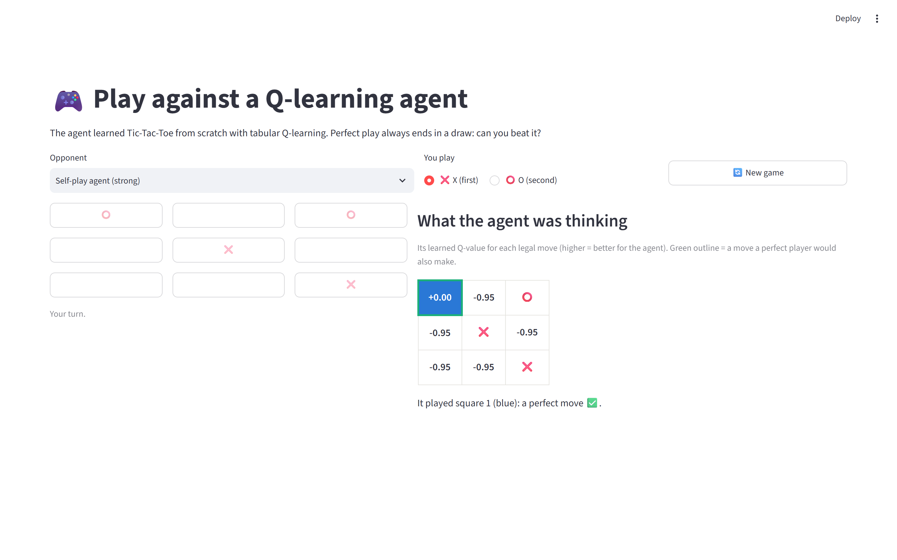
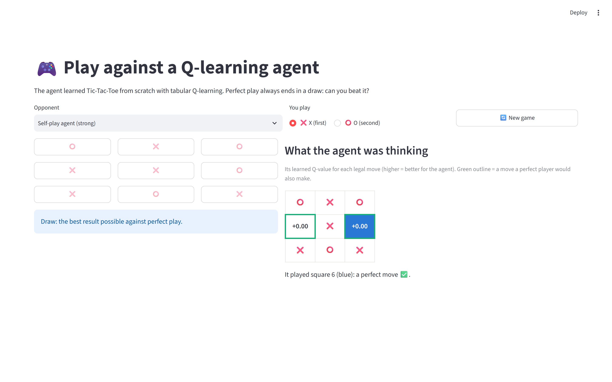
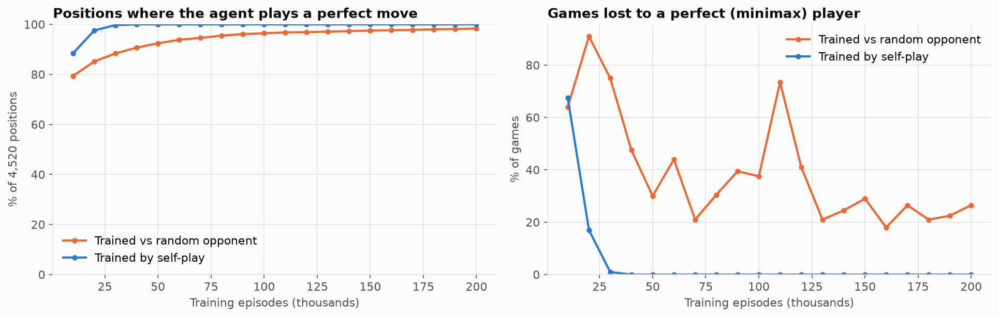
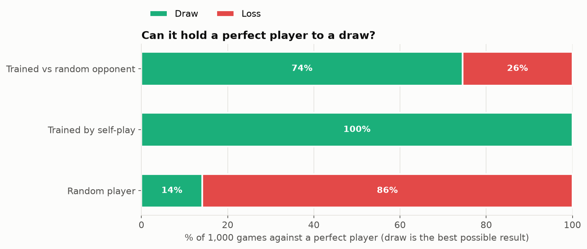

# Q-learning Tic-Tac-Toe: does it actually play perfectly?


A tabular Q-learning agent that learns Tic-Tac-Toe from scratch, evaluated the way game AI should be: not just against a random opponent, but against a **perfect minimax player** and on **every one of the 4,520 possible positions**. It compares two training regimes, and a Streamlit app lets you play the agent and see its Q-values for every move.

| The agent sees one move draws (+0.00) and all others lose (−0.95) | Game result: a draw, the best possible against perfect play |
|---|---|
|  |  |

## Results

200,000 training episodes per agent (about a minute each on a laptop CPU). Evaluation games alternate sides (half as X, half as O).

| Agent | Perfect moves (of 4,520 positions) | vs random player: win / draw / loss | vs perfect player: draw / loss |
|---|---|---|---|
| Trained vs a random opponent | 98.3% | **94.8%** / 4.5% / 0.6% | 74.5% / **25.5%** |
| **Trained by self-play** | **100%** | 87.3% / 12.7% / **0%** | **100% / 0%** |
| Random player (baseline) | — | 44.4% / 12.8% / 42.8% | 14.1% / 85.9% |



### What the numbers say

- **Self-play learns perfect play.** By 40,000 episodes the self-play agent chooses a minimax-optimal move in **all 4,520 positions**, and it never loses a game to the perfect player, as X or as O.
- **Beating a random opponent is a misleading benchmark.** The agent trained against random play wins *more* against random opponents (94.8% vs 87.3%), yet it **loses 25.5% of games to a perfect player**. All of those losses come when it plays O (51% of its O games).
- **98% isn't 100%.** The random-trained agent plays perfectly in 98.3% of positions, but its remaining mistakes sit exactly on the lines a strong opponent steers into, and a random opponent almost never plays them. Its loss curve against minimax stays jumpy for that reason: small changes in rarely visited states flip whole game outcomes.
- **Why self-play works:** the opponent improves along with the agent, so it keeps being shown its own weaknesses. Against a fixed random opponent, a weakness that the opponent never exploits is never punished.



## How it works

- **Environment:** `tictactoe_rl/game.py` holds the rules plus a memoised **minimax** solver. It gives the value of any position and the set of optimal moves.
- **Agent:** `tictactoe_rl/agent.py` is tabular Q-learning (α = 0.3, γ = 0.95, ε decaying linearly from 1.0 to 0.05).
  - The board is stored from the **mover's point of view** (own marks = +1), so one Q-table plays both X and O.
  - **Training vs a fixed opponent:** standard Q-learning on the agent's own decision points; it alternates between X and O.
  - **Self-play:** both sides share the table with a negamax-style target, *my value after a move = −(opponent's best value)*. Win = +1, draw = 0.
- **Evaluation:** `tictactoe_rl/evaluate.py` runs matches against random and minimax players, and the **optimal-move rate** checks the agent's greedy move in every reachable non-terminal position against minimax.

## Play it

```bash
streamlit run app/streamlit_app.py
```

Choose the strong (self-play) or weaker (random-trained) agent and your side. After each of its moves, the panel shows its Q-value for every legal square, which square it picked (blue), and which squares a perfect player would pick (green outline).

## Project structure

```
├── tictactoe_rl/
│   ├── game.py        # Rules, minimax solver, random and perfect players
│   ├── agent.py       # Q-learning agent: training vs an opponent, self-play, save/load
│   ├── evaluate.py    # Matches and optimal-move rate
│   └── train.py       # Trains both regimes, learning curves -> models/, reports/
├── app/streamlit_app.py
├── models/            # q_self.pkl, q_random.pkl (Q-tables)
├── reports/           # results.md, metrics.json (incl. learning curves), train_log.txt, figures/
├── notebooks/         # The original classroom notebook and Tkinter app
└── tests/
```

## Quickstart

```bash
git clone https://github.com/arslanahmedbhutto/rl-tictactoe-qlearning.git
cd rl-tictactoe-qlearning
python -m venv .venv
source .venv/bin/activate          # Windows: .venv\Scripts\activate
pip install -r requirements.txt
python -m tictactoe_rl.train       # a few minutes, including evaluations
streamlit run app/streamlit_app.py
pytest
```

## Related

[lora-qlora-finetuning](https://github.com/arslanahmedbhutto/lora-qlora-finetuning) · [stock-forecasting-lstm-gru](https://github.com/arslanahmedbhutto/stock-forecasting-lstm-gru): more projects where the baseline matters
